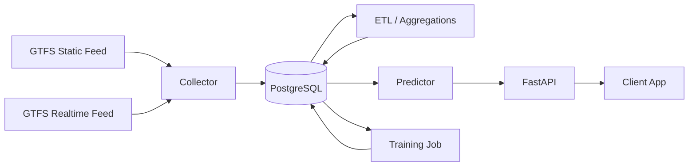
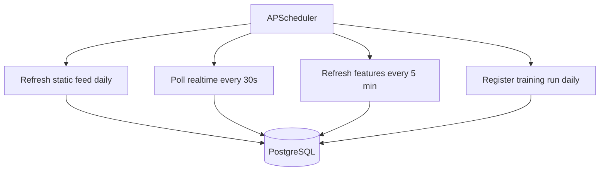

# Knightbus

Backend for collecting GTFS static/realtime data and serving RapidKL bus ETA predictions.

## Stack

- Python 3.12
- `uv` for dependency management
- FastAPI
- PostgreSQL
- APScheduler
- SQLAlchemy

## Quick start

1. Copy `.env.example` to `.env` and fill in the GTFS feed URLs.
2. Install `uv` if it is not already available on your machine:

```bash
curl -LsSf https://astral.sh/uv/install.sh | sh
```

3. Sync dependencies:

```bash
uv sync
```

4. Start the API locally:

```bash
uv run uvicorn knightbus.main:app --reload
```

5. Start the scheduler/collector worker:

```bash
uv run python -m knightbus.scheduler
```

6. Run one-off data collection manually:

```bash
uv run python scripts/collect.py
```

7. Run one-off training manually:

```bash
uv run python scripts/train.py
```

8. Run tests:

```bash
uv run pytest
```

9. Or run both with Docker Compose:

```bash
docker compose up --build
```

## Architecture



## Runtime workflow



## Current behavior

- Loads GTFS static ZIP files into PostgreSQL
- Polls GTFS-realtime vehicle/trip feeds on a schedule
- Stores raw and normalized snapshots
- Serves stop ETAs using schedule + realtime delay heuristics
- Exposes a placeholder training command for later ML work

## Layout

- `src/knightbus`: application code
- `scripts/collect.py`: one-off static + realtime collection and feature refresh
- `scripts/train.py`: one-off training entrypoint
- `tests`: basic unit tests
- `AGENTS.md`: repo instructions for future coding agents
- `PLAN.md`: implementation and operating plan

## Where the core logic lives

- Data collection: `src/knightbus/collector.py`
- Scheduled workflows: `src/knightbus/scheduler.py`
- ETL and aggregations: `src/knightbus/etl.py`
- ETA prediction: `src/knightbus/predictor.py`
- Training registration: `src/knightbus/training.py`

## Default deployment shape

- One VM
- One Postgres instance
- One API process
- One worker process using APScheduler
- No Redis, Celery, Airflow, or Kubernetes in v1
